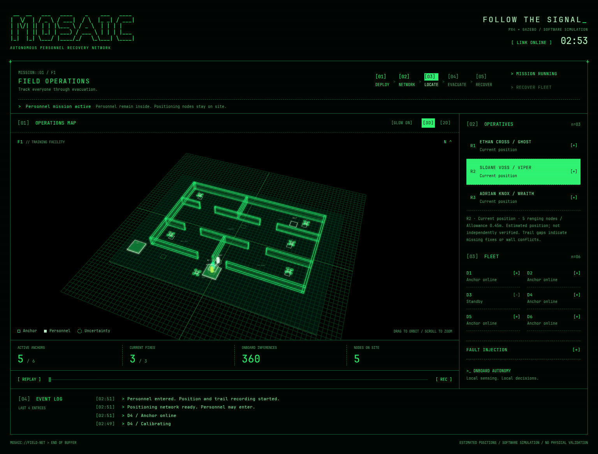

# MOSAIC

MOSAIC is an emergency-personnel localization simulator. Six drones run in PX4 and Gazebo. They fly into a training building, avoid obstacles, and perch to form a UWB ranging network. A local browser console tracks three enrolled personnel through the indoor objective and outdoor evacuation, then the drones return to launch.



## Quick start

On Linux, install a C++20 compiler, CMake 3.20 or newer, Python 3.11 or newer, and Node.js for the JavaScript tests. For example, on Ubuntu 24.04:

```sh
sudo apt-get install build-essential cmake python3 nodejs
cmake -S . -B build -DCMAKE_BUILD_TYPE=Release
cmake --build build --parallel 2
ctest --test-dir build --output-on-failure
```

The quick checks build the C++ mission engine and exercise localization, planning, recording, fault handling, and console logic. They require no PX4 or Gazebo installation.

## Run the simulation

The live demo runs on Linux x86-64 with Python 3.11+, bubblewrap (`bwrap`), and unprivileged user namespaces. The launcher looks for the prepared PX4/Gazebo runtime in `.runtime/toolchain/`.

From the project root, clear any previous toolchain override and start the demo:

```sh
unset MOSAIC_TOOLCHAIN
python3 -B scripts/mission_run.py --auto --faults --reroute
```

Include the hidden `.runtime/` directory when sharing a copy of the project with the runtime installed. Git clones contain the source files. If you have a source-only checkout or a runtime installed elsewhere, follow the [runtime setup guide](docs/mission-operations.md).

Open <http://127.0.0.1:8766> in a WebGL-capable browser. The scenario deploys the fleet, injects a 25-second command-link outage and a ranging-node fault, and takes the west evacuation detour. Leave the terminal open to review the recording when the mission completes. Press **Ctrl+C** and wait for `Session saved` to shut down. Run the same command without options to make control decisions in the console.

The aircraft use real PX4 flight controllers with Gazebo physics. Local odometry, UWB propagation, perching, and personnel movement are simulated. The scenario assumes a single floor, an approximate prior map, and cooperative personnel wearing enrolled tags.

## Find your way around

| I want to… | Start here |
| --- | --- |
| Lead or present the demo | [Demo walkthrough](docs/mission-demo.md) |
| Set up the runtime, choose flags, or locate recordings | [Operations](docs/mission-operations.md) |
| Understand autonomy, ranging, and data boundaries | [Architecture](docs/mission-architecture.md) |
| Understand why the detour requires extra coverage | [Evacuation and handover](docs/mission-evacuation.md) |
| Change the code and run checks | [Contributing](CONTRIBUTING.md) and [development](docs/development.md) |
| Evaluate results or prepare a runtime bundle | [Verification](docs/mission-delivery.md) and [packaging](docs/release.md) |

## Licensing

MOSAIC's original code, documentation, and assets are all rights reserved under [LICENSE.md](LICENSE.md). Bundled dependencies retain their own terms. See [third-party notices](THIRD_PARTY_NOTICES.md).
