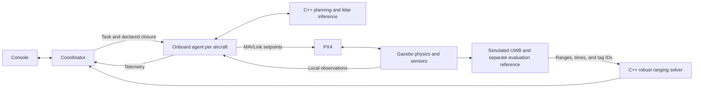

# Architecture

Gazebo Harmonic simulates physics, motors, lidar, inertial sensors, and local odometry. Six PX4 SITL instances use those observations to control separate aircraft. Each aircraft runs its own Python mission agent and C++20 compute process. The browser console reads local HTTP state and sends operator commands.

## Onboard planning

`mission_world.py` generates the scene and `mission_sitl.py` manages PX4 and Gazebo. Each agent receives the wall-map prior and task goal. It projects lidar using a fresh local pose, updates occupancy from observed free and occupied space, and replans when obstructed. The agent discards world pose fields carried by simulator lidar messages.

A* connects non-grid endpoints to visible, free grid cells. The reference planner uses a 0.58 m obstacle margin and a 0.15 m waypoint arrival radius. If a recent observation places the aircraft within the extra planning margin, it may first use an exit segment of at most 1 m while maintaining the 0.35 m local clearance. With insufficient clearance or expired sensor data, the agent holds position.

The 9-input, 24-hidden-unit, 3-output lidar MLP estimates clear, caution, and blocked classes. It adjusts the local look-ahead distance while obstacle geometry constrains the path. The checked-in weights come from 18,000 synthetic training examples (seed 4103) and evaluation on 4,000 held-out examples (seed 9817). See the [development guide](development.md) to reproduce training.

## Perching and ranging

Aircraft must physically land and disarm inside the simulated perch tolerance. The anchor coordinate is the mean of its onboard position estimates after landing. A separate radio process generates noisy ranges, wall bias, and dropped samples. The C++ solver tests three-anchor hypotheses and uses consistent ranges in a weighted nonlinear fit.

The radio process keeps simulator truth for observation generation and independent evaluation. The coordinator and console use estimated positions. Arrival requires fresh fixes with observation age at most 0.4 seconds and a two-second continuous dwell. Missing fixes reset the dwell. Route validation checks each configured segment against walls, obstacles, and bounds with the reference scene's 0.3 m personnel clearance.

## Faults and status

- During a command-link outage, the transport drops queued telemetry and new commands. Agents continue the tasks they already received. Stationary calibrated anchors can still serve fresh UWB measurements through the independent ranging path.
- When one node stops sending ranges, the coordinator detects a timeout, excludes it, and dispatches the reserve aircraft. Service recovery requires fresh fixes for everyone for five seconds and is recorded separately from the reserve aircraft completing its landing and calibration.
- An independent simulated battery publisher follows Gazebo time. PX4 retains its battery freshness and arming checks.
- The console expires observations on HTTP loss or frozen telemetry. Replay reads recorded states and locks control commands. Missing fixes and wall-crossing links appear as trail gaps.

See [evacuation and handover](mission-evacuation.md) for the indoor-to-outdoor transition.
